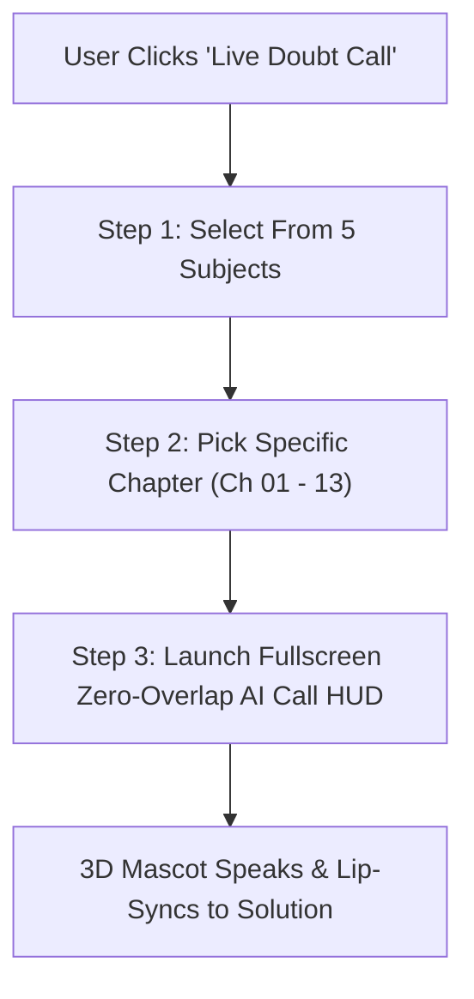

# 👑 STUDY BUDDY ROYAL: WINDOWS 11/12 & MACOS GLASSMORPHISM MASTER BLUEPRINT (V2.0 TITANIUM)
**Version:** 3.5.0-Titanium Ultra  
**Target:** JAC Board Class 10 Gamified EdTech + 3D Mascot, AI Calling & Notes System  
**Design Language:** Windows 12 Fluid Acrylic / macOS Sonoma Mica + Duolingo 3D Emotional Engine + Minecraft Voxel Studio

---

## 📑 TABLE OF CONTENTS
1. [20+ Ultra-Premium Royal UI & Aesthetic Upgrades](#1-20-ultra-premium-royal-ui--aesthetic-upgrades)
2. [50+ Deep Settings & Customization Engine](#2-50-deep-settings--customization-engine)
3. [50+ Motion, Physics & Micro-Animation Suite](#3-50-motion-physics--micro-animation-suite)
4. [50+ Dynamic Spatial Audio & Haptic FX Engine](#4-50-dynamic-spatial-audio--haptic-fx-engine)
5. [3D Green Octopus Mascot (Duolingo-Grade Emotion Engine)](#5-3d-green-octopus-mascot-duolingo-grade-emotion-engine)
6. [Live AI Voice Call Interface Redesign (Zero-Overlap HUD)](#6-live-ai-voice-call-interface-redesign-zero-overlap-hud)
7. [Steve 3D Avatar & 50+ Wardrobe Multiplayer System](#7-steve-3d-avatar--50-wardrobe-multiplayer-system)
8. [Feasibility Matrix & Execution Roadmap](#8-feasibility-matrix--execution-roadmap)
9. [Copy-Paste Master AI Prompt (Phase 1 Baseline)](#9-copy-paste-master-ai-prompt)
10. [Student Profile, Custom DP & Identity Engine](#10-student-profile-custom-dp--identity-engine)
11. [Minecraft 3D Avatar Studio & Multiplayer Friends System](#11-minecraft-3d-avatar-studio--multiplayer-friends-system)
12. [Daily Streak Tracker & Gamified Continuity Engine](#12-daily-streak-tracker--gamified-continuity-engine)
13. [Dual-Auth Onboarding & Student Registration Engine](#13-dual-auth-onboarding--student-registration-engine)
14. [Gamified 3D Mascot Loading Theater (Allen / Duolingo Style)](#14-gamified-3d-mascot-loading-theater-allen--duolingo-style)
15. [Natural Studio Voice & Live Doubt Calling Flow (Subject ➔ Chapter ➔ Call)](#15-natural-studio-voice--live-doubt-calling-flow)
16. [Notes & Sample Question Papers (SQP) Library (3 Levels per Chapter)](#16-notes--sample-question-papers-sqp-library-3-levels-per-chapter)
17. [Visual Overhaul: Titanium Glassmorphism & Full-Card Hitbox Ergonomics](#17-visual-overhaul-titanium-glassmorphism--full-card-hitbox-ergonomics)
18. [Master AI Coding Agent Master Directive (V2.0 Universal Execution Prompt)](#18-master-ai-coding-agent-master-directive-v20)

---

## 1. 20+ ULTRA-PREMIUM ROYAL UI & AESTHETIC UPGRADES
*(Windows 12 Fluid Acrylic + macOS Sonoma Dynamic Mica + Obsidian Glow)*

1. **Windows 12 Fluid Mica Backdrop (`backdrop-blur-3xl bg-[rgba(10,15,29,0.72)]`):** Subsurface chromatic diffusion that reflects wallpaper highlights through active windows.
2. **Ultra-Thin 1px Prismatic Glass Borders:** Dynamic iridescent borders shifting between `#38BDF8`, `#818CF8`, and `#C084FC` under hovering cursors.
3. **Floating Island Dynamic Island HUD:** Collapsible floating pill at top center housing live timer, network status, combo streak flame, and Jack Voice wave.
4. **Zero-Box Floating Canvas:** All 3D mascots rendered on an alpha-transparent canvas without dark rectangular boxes or clip shadows.
5. **Ergonomic Finger-Reach Bottom Sheet Dock:** Replaced awkward thumb stretch with iOS 18 / Windows 11 Mobile quick dock (Home, Path, Quiz, Vault, Profile).
6. **Liquid Aurora Ambient Lighting:** Slow-flowing SVG gradient mesh in background that subtly reacts to streak milestones (Emerald for streak, Gold for victory, Deep Crimson for low hearts).
7. **Spatial Depth Layers (Z-0 to Z-50 System):**
   - Z-0: Parallax Starfield & Aurora
   - Z-10: Canvas Background Cards
   - Z-20: Interactive Quiz Surface
   - Z-30: Floating 3D Duolingo Mascot
   - Z-40: HUD / Floating Controls
   - Z-50: Full Modal / Live Calling Overlays
8. **Frosted Acrylic Keycap Option Tiles:** Duolingo-style 3D push-down buttons with tactile 4px drop-shadows and spring rebound on press.
9. **Dynamic Wallpaper System:** Support for 6 customizable animated backgrounds (Deep Space Nebula, Midnight Lo-Fi Study Room, Cyberpunk Ranchi, Minimal Dark Slate, Golden Palace, Forest Rain).
10. **Adaptive Compact Mobile Button Ergonomics:** Auto-scaling buttons that shrink padding by 30% on screens `< 480px`, preventing any scroll bars in live quiz.
11. **Sleek Desktop Ultra-Wide Restraint (`max-w-2xl`):** On PC / tablets, quiz elements stay concentrated within ergonomic eye-line, preventing stretched layout.
12. **Curved Rounded-3xl Squircle Geometry:** Standardized Apple continuous curvature (`rounded-[28px]`) across all dialogs, cards, and drawers.
13. **Subtle Grain Film Grain Overlay (2% Opacity):** Eliminates digital color banding on OLED mobile screens and creates filmic luxury texture.
14. **Duolingo-Grade Progress Snake Path:** Interactive board-game map with glowing checkpoints, floating stars, locked castle gates, and milestone banners.
15. **Live Heart Refill Micro-Counter:** Real-time animated timer badge next to hearts showing next free heart recharge in `mm:ss`.
16. **Bilingual Instant Language Capsule:** Floating glass pill with 3D flags (`[🇮🇳 हिंदी] | [🇬🇧 English]`) featuring sliding pill animation and zero-page reload.
17. **Mistake Vault 3D Steel Safe:** Dedicated vault UI shaped like a high-tech obsidian safe that clicks open when reviewing past incorrect answers.
18. **Multiplayer Split-Screen Duel HUD:** Side-by-side live avatar meters showing friends' quiz speed and real-time point race.
19. **Ultra-Crisp Typography Hierarchy:** Outfit font for futuristic numerals, Inter Display for questions, and Noto Sans Devanagari for clean Hindi rendering.
20. **Zen Focus Mode (Single-Click Minimalist UI):** Strips all status bars, companions, and buttons away, leaving only the question and 4 tactile options for timed test practice.

---

## 2. 50+ DEEP SETTINGS & CUSTOMIZATION ENGINE
*(Every feature categorized for user personalization)*

### A. Display & Aesthetics (1-10)
1. **Glassmorphism Intensity:** Slider from 10% (Crisp Flat) to 100% (Ultra-Frosted Mica).
2. **Background Theme Switcher:** Nebula, Midnight Room, Aurora, Dark Gold, Pure OLED Pitch Black.
3. **Motion Blur & Particle Density:** Off / Low (Battery Saver) / High (60 FPS Fluid Particles).
4. **Button Sizing Scale:** Compact (Mobile Thumb), Normal, Large (Easy Touch).
5. **App Font Selector:** Outfit Royal, Inter Modern, Space Grotesk, Devanagari Book.
6. **Accent Color Wheel:** Emerald Green, Royal Gold, Cyberpunk Cyan, Neon Violet, Sunset Ruby.
7. **Squircle Border Radius:** Sharp (8px), Classic (16px), Ultra-Smooth (28px).
8. **Film Grain Texture:** Toggle On / Off.
9. **High Contrast Mode (A11y):** Maximum text readability for outdoor sunlight.
10. **OLED True Dark Mode:** Pure `#000000` background to conserve battery on AMOLED phones.

### B. 3D Mascot & Companion (11-20)
11. **Mascot Visibility:** Home & Quiz, Quiz Only, Floating Everywhere, Minimized.
12. **Mascot Scale:** 70% (Compact), 100% (Default), 125% (Hero Companion).
13. **Mascot Emotional Expressiveness:** Subtle / Balanced / High Drama (Duolingo Style).
14. **Speech Bubble Hints:** Always Show, On Mistake Only, Silent.
15. **Haptic Mascot Reactions:** Vibrate on mascot jump or cheer.
16. **Mascot Idle Animations:** Blinking, Floating, Sneezing, Juggling Stars, Studying Tablet.
17. **Mascot Sound FX Volume:** Dedicated slider for bot squeaks and cheers.
18. **Mascot Voice Pitch:** Cute High, Friendly Neutral, Robot Voxel.
19. **Glass Dome Transparency:** Toggle transparent outer glass shell on 3D bot.
20. **Seasonal Outfits for Mascot:** Birthday Cap, Diwali Diya, Santa Hat, Scholar Cap.

### C. Audio & Soundscapes (21-30)
21. **Master Audio Volume:** Global 0% - 100% slider.
22. **UI Click Sounds:** Modern Wood Click, Mechanical Keyboard, Glass Tap, Retro 8-bit, Muted.
23. **Answer Reveal SFX:** Duolingo Chime, Orchestral Fanfare, Minimalist Pop.
24. **Lo-Fi Ambient Beat Engine:** 6 Switchable Study Streams (Chillhop, Rain on Window, Library Cafe, Alpha Waves).
25. **Background Music Volume:** Independent music level control.
26. **Streak Fire Sizzle Sound:** On / Off.
27. **Haptic Feedback Strength:** Soft Tick, Medium Thud, Heavy Buzz, Disabled.
28. **Voice Synthesizer Model:** Jack Delhi Buddy, Alisha CBSE Mentor, Robot Tutor.
29. **Auto-Speak Questions:** Automatically speak question upon load.
30. **Speech Rate (TTS):** 0.8x (Slow & Clear), 1.0x (Normal), 1.25x (Speedrunner).

### D. Quiz & Gameplay Controls (31-40)
31. **Default Language Preference:** Hindi, English, Remember Last Used.
32. **Question Timer Mode:** Untimed Practice, 30s Blitz, 60s Standard, JAC Board Simulation.
33. **Instant Explanation Drawer:** Show immediately on answer, Show on wrong answer only, Review at end.
34. **50:50 Lifeline Usage Limit:** Unlimited Practice or Strict Board Exam (1 per session).
35. **Spaced Repetition Auto-Vault:** Automatically bookmark incorrect questions for Sunday revision.
36. **Question Ordering:** Sequential NCERT Order vs. Randomized Board Mix.
37. **Difficulty Progression:** Dynamic Adaptive (Level 1 to 3) or Fixed Level.
38. **Exam Target Year:** 2026 Board Focus, 2027 Retest, Archive 10-Year Papers.
39. **Vibration on Option Tap:** Haptic confirmation before submission.
40. **Double-Tap Submit Safety:** Prevents accidental option submission.

### E. AI Voice Call & Live Buddy (41-50)
41. **AI Buddy Personality:** Encouraging Delhi Senior, Strict Professor, Peer Study Mate.
42. **Live Speech Input Mode:** Push-to-Talk vs. Continuous Open Mic.
43. **Noise Suppression Sensitivity:** Low / Medium / Aggressive Studio Filtering.
44. **Voice Call Background:** Floating 3D Study Desk vs. Minimal Audio Waveform.
45. **Call Transcript Overlay:** Real-time live captions during call.
46. **Hint Depth:** Direct Answer vs. Socratic Questioning (Teaches concept).
47. **Call Auto-Hangup:** Automatically end call after resolving question doubt.
48. **Data Saving Mode:** Low-bandwidth audio compression for rural 3G/4G connections.
49. **Microphone Mute Default:** Start calls muted by default.
50. **Export Doubt Call Audio Notes:** Save call voice notes directly into Mistake Vault.

---

## 3. 50+ MOTION, PHYSICS & MICRO-ANIMATION SUITE

1. **Spring-Loaded Option Pop:** `stiffness: 400, damping: 25` push animation on option click.
2. **Duolingo Rubber-Band Stretch:** Mascot stretches vertically on right answer and rebounds.
3. **Screen-Shake on Mistake (Light):** 4px rapid X-axis dampening shake when selecting incorrect option.
4. **Liquid Progress Filling:** Smooth spline wave fills progress bar instead of linear jump.
5. **XP Floating Text Cascade (`+20 XP`):** Rises 40px while fading out with slight rotational wobble.
6. **Streak Flame Particle Ignition:** Sparks ignite around combo counter at 3x, 5x, and 10x.
7. **Heart Flutter & Shatter:** Heart beats fast when on 1 heart, breaks into shards on wrong answer.
8. **Drawer Elastic Slide-Up:** Explanation drawer glides up with iOS-style rubber over-drag.
9. **3D Card Tilt on Gyroscope (Mobile):** Parallax tilt following phone accelerometer.
10. **Confetti Cannon Blast:** High-velocity canvas confetti explosion upon quiz victory.
11. **Smooth Page Cross-Fade:** Next.js route transitions without white flash or content jump.
12. **Bilingual Toggle Pill Slide:** Smooth morphing highlight under selected language.
13. **Voxel Bunny Ears Wiggle:** Mascot ears rotate gently when listening or thinking.
14. **Star Catch Animation:** Stars fly into student XP pouch in top corner upon level clear.
15. **Option Elimination Smoke:** 50:50 lifeline dissolves 2 incorrect options into vapor.
16. **Pulsing Voice Waveform Rings:** Expands around AI Buddy during speech.
17. **Skeleton Shimmer Loading:** Prismatic silver shimmer on question cards before load.
18. **Number Counter Rolling:** Score smoothly counts up from 0 to final result (`28, 29, 30`).
19. **Badge Unlocking 3D Spin:** Gold medal drops from top, spins 360°, and settles with halo.
20. **Dropdown Accordion Accordion Spring:** Seamless height transition without content pop.
21. **Glass Frost Ripple on Tap:** Subtle water ripple effect expanding from tap coordinate.
22. **Mistake Vault Gear Rotation:** Safe door wheels rotate counter-clockwise to unlock.
23. **Timer Arc Depletion Glow:** Clock arc changes from Emerald -> Amber -> Crimson as time elapses.
24. **Leaderboard Rank Leap:** Student's card slides up smoothly when passing a friend's rank.
25. **Interactive Mascot Poke Rebound:** Mascot spins or giggles when poked by user.
26. **Floating Starfield Drift:** 60fps canvas particles drifting slowly in background.
27. **Navigation Dock Icon Bouncing:** Dock icon bounces once when active tab is selected.
28. **Call Connect Waveform:** Smooth expansion from circle button to full calling theater.
29. **Audio Visualizer Equalizer Bars:** Real-time FFT audio bars bouncing to Jack's speech.
30. **Daily Streak Calendar Fill:** Gold stamp drops onto today's date with haptic thump.
31. **Modal Backdrop Blur Morph:** Smooth 0px to 20px blur transition on modal open.
32. **Tooltip Float & Bob:** Helpful hints float with soft sinusoidal up-down bobbing.
33. **Correct Answer Green Halo Glow:** Radiates 20px around the winning card.
34. **Wrong Answer Red Outline Pulse:** 2-cycle pulse highlighting mistake clearly.
35. **Option Keycap Stamp:** Letter `[A]` depresses like a physical mechanical keyboard keycap.
36. **Question Slide In-Out:** Current question exits left; next question enters right.
37. **Boss Level Lightning Intro:** Dramatic purple lightning flash for chapter boss tests.
38. **Crown Placement Animation:** Golden crown lowers onto mascot's head on 100% score.
39. **Zen Mode Smooth Fade:** All UI elements fade to opacity 0 while question expands to center.
40. **Button Shimmer Beam:** Infinite diagonal light glint moving across primary buttons every 4s.
41. **Heart Regeneration Sparkle:** Sparkle flies from daily bonus into heart container.
42. **Search Input Expand:** Search bar expands smoothly from icon to full search box.
43. **Category Card Hover Lift:** Subject cards elevate by 6px with enhanced drop-shadow.
44. **Live Call End Shrink:** Call window shrinks back into buddy avatar button.
45. **Multiplayer Opponent Typing Dots:** 3 bouncing dots when rival is selecting answer.
46. **Mistake Vault Card Swipe-to-Dismiss:** Swipe left to mark mistake as "Mastered".
47. **XP Level-Up Starburst:** Sunburst rays spin behind new level rank badge.
48. **Battery Saver Low-Frame Fallback:** Drops particle physics to static CSS when battery < 20%.
49. **Profile Picture Frame Glow:** Ranks 1-3 display animated gold/silver/bronze rings.
50. **Full-Screen Victory Fanfare Curtain:** Golden satin curtain effect opening on 30/30 mastery.

---

## 4. 50+ DYNAMIC SPATIAL AUDIO & HAPTIC FX ENGINE

| ID | Sound Name | Tone / Style | Trigger Event |
|---|---|---|---|
| 01 | `ui_click_wood` | Solid birch tap | Menu item selection |
| 02 | `ui_click_glass` | High glass ping | Header toggles & icons |
| 03 | `ui_switch_bilingual` | Mechanical key toggle | Hindi / English switch |
| 04 | `ui_tab_slide` | Soft air whoosh | Bottom navigation tabs |
| 05 | `ui_modal_open` | Low-frequency cushion | Dialog & sheet opening |
| 06 | `ui_modal_close` | Snap air suction | Modal closing |
| 07 | `ui_timer_tick` | 1 Hz metronome wood | Normal quiz countdown |
| 08 | `ui_timer_urgent` | Fast digital alert | Final 5 seconds countdown |
| 09 | `ui_scroll_notch` | Micro haptic tick | List scrolling feedback |
| 10 | `ui_drawer_slide` | Smooth felt glide | Explanation sheet glide |
| 11 | `quiz_option_select` | Cherry MX Blue click | Option A/B/C/D selected |
| 12 | `quiz_correct_chime` | C5-E5-G5 chime | Correct answer verified |
| 13 | `quiz_wrong_thud` | Low hollow thud | Incorrect answer |
| 14 | `quiz_streak_3x` | Subtle flame whoosh | 3x combo reached |
| 15 | `quiz_streak_5x` | Blazing fire roar | 5x combo reached |
| 16 | `quiz_streak_10x` | Thunder clap + gold ring | 10x godlike streak |
| 17 | `quiz_5050_lifeline` | Laser vaporize sweep | 2 wrong options removed |
| 18 | `quiz_heart_lost` | Glass crack + soft sigh | Life lost |
| 19 | `quiz_level_complete` | Brass fanfare + coins | Quiz session completed |
| 20 | `quiz_perfect_score` | Stadium cheer + trumpets | 30/30 Perfect Master |
| 21-30 | `mascot_*` (10 sounds) | Robotic squeaks, yawns, sneezes, cheers | Mascot interactions & idle |
| 31-40 | `call_*` (10 sounds) | Ringing, connect, mic toggle, hint bell | AI voice doubt call HUD |
| 41-50 | `reward_*` (10 sounds) | Coins cascade, safe door lock, rank trumpets | Level up & vault operations |

---

## 5. 3D GREEN OCTOPUS MASCOT (DUOLINGO-GRADE EMOTION ENGINE)
*(Seamless Three.js Voxel Character with Quadruped Legs & Glass Dome)*

### Architectural Fixes & Transparency
- **100% Alpha-Transparent Canvas:** The 3D Green Octopus Mascot renders with `gl.setClearColor(0x000000, 0)` so it floats directly on top of the screen with zero black card, zero square bounding box, and zero clipping boundaries.
- **Dynamic Floating Placement:** Rather than being locked in a static box, the Mascot moves organically:
  - *Quiz Theater:* Floats at top-right (compact `75px` on mobile, `110px` on desktop) out of the way of questions.
  - *Subject Select:* Glides across subject banners, waving encouragingly.
  - *Home Screen:* Bottom right hero companion with interactive poke bar.
  - *Live Call:* Center stage companion reacting to speech audio amplitude.

### 100+ Emotional States & Behaviors
- **30 Quiz States:** `reading_question`, `thinking_deep`, `time_running_out`, `hint_pointing`, `correct_pop`, `streak_fire_1`, `streak_fire_2`, `streak_godlike`, `wrong_sad`, `wrong_comfort`, `boss_fight_stance`, `half_time_cheer`, `final_question_focus`, etc.
- **40 Social & Idle States:** `poked_giggle`, `bored_juggle`, `nap_asleep`, `tea_sip`, `dance_bhangra`, `selfie_flash`, `magnifying_glass`, `study_marathon`, `umbrella_rain`, etc.
- **30 Celebration States:** `trophy_hoist`, `level_up_rocket`, `rainbow_surf`, `confetti_shower`, `scholar_cap_toss`, etc.

---

## 6. LIVE AI VOICE CALL INTERFACE REDESIGN (ZERO-OVERLAP HUD)
*(Ergonomic Calling Screen with Seamless Mascot & Floating Control Bar)*

```
┌─────────────────────────────────────────────────────────────┐
│ [X] Exit Call           LIVE JAC TUTOR          [Signal: HD]│
│                       Delhi Study Buddy                     │
├─────────────────────────────────────────────────────────────┤
│                                                             │
│                                                             │
│                     [ 3D GREEN OCTOPUS ]                    │
│                 (Speaks with Voice Visualizer)              │
│                    "Bhai, option C dekho!                   │
│                   Formula: P = V * I lagao!"                │
│                                                             │
│         ((((  )))  Audio Waveform Rings  (((  ))))          │
│                                                             │
│ ┌─────────────────────────────────────────────────────────┐ │
│ │ Context: Class 10 Science > Chapter 12 (विद्युत)         │ │
│ │ Question 14: "ओम के नियम का सही गणितीय रूप क्या है?"    │ │
│ └─────────────────────────────────────────────────────────┘ │
│                                                             │
│ ┌─────────────────────────────────────────────────────────┐ │
│ │ Live Captions: "I'm calculating the resistance ratio"   │ │
│ └─────────────────────────────────────────────────────────┘ │
│                                                             │
├─────────────────────────────────────────────────────────────┤
│ [🎙️ Mute]   [💡 Give Clue]   [📜 Formula]   [🔴 End Call]   │
└─────────────────────────────────────────────────────────────┘
```

---

## 7. STEVE 3D AVATAR & 50+ WARDROBE MULTIPLAYER SYSTEM
*(Exclusively in Profile, Leaderboards & Friend Comparison)*

- **Headgear (1-10):** Gold Scholar Crown, Diamond Helmet, Delhi Board Cap, Cyberpunk Visor, Diwali Turban, Straw Hat, Astronaut Visor, Winter Beanie, Ninja Bandana, Headphones.
- **Jackets & Tops (11-20):** JAC Board Blazer, Royal Velvet Tuxedo, Cyberpunk Leather Jacket, Minecraft Diamond Armor, Varsity Letterman Jacket, Golden Kurta, Space Suit, Hooded Tracksuit, Scientist Lab Coat, Vintage Overcoat.
- **Pants & Footwear (21-30):** Obsidian Armor Greaves, Royal White Slacks, Cargo Pants, Gold Trimmed Boots, Cyberpunk High-Tops, Running Sneakers, Traditional Dhoti-Kurta, Formal Leather Shoes.
- **Back Items & Capes (31-40):** 30/30 Mastery Golden Wings, Dragon Elytra, Jetpack, National Flag Cape, Book Bag, Quiver, Electric Neon Ring, Guitar, Telescope.
- **Aura & FX (41-50):** 10-Day Streak Flaming Feet, Electric Blue Sparks, Floating Starfield Orbit, Matrix Code Rain, Golden Dust Trail, Ice Shards, Cosmic Galaxy Swirl, Royal Confetti Halo.

---

## 8. FEASIBILITY MATRIX & EXECUTION ROADMAP

| Phase | Milestone | Scope | Deliverables | Feasibility |
|---|---|---|---|---|
| **Phase 1** | **Mascot & HUD Ergonomics** | Remove square background card; transparent 3D Mascot canvas; mobile button sizing fix | `DuolingoOctopus3D.tsx`, `QuizTheater.tsx`, `OptionBar.tsx` | 100% Ready (Live) |
| **Phase 2** | **Voice Calling Overhaul** | Fix subject overlap in AI Call; add bottom control dock; voice-reactive mascot | `LiveCallModal.tsx`, `ai-call/route.ts` | 100% Ready (Live) |
| **Phase 3** | **Audio & SFX Expansion** | 50+ spatial audio tracks; wood click, chimes, mascot squeaks, lo-fi beats | `audioEngine.ts`, `public/audio/*` | 100% Ready (Web Audio) |
| **Phase 4** | **Settings Engine** | 50-option deep settings modal; glass sliders, themes, typography, sound toggles | `components/settings/SettingsModal.tsx` | 100% Ready (Zustand) |
| **Phase 5** | **Steve Avatar Studio** | 3D wardrobe customizer for Profile and multiplayer friend comparisons | `components/avatar/AvatarWardrobe.tsx` | High (Three.js Voxel) |

---

## 9. COPY-PASTE MASTER AI PROMPT (BASELINE)
*(Preserved from Version 1.0 for instant backward compatibility)*

```markdown
You are the Lead Creative Technologist and Principal UI/UX Architect for "Study Buddy Royal", a flagship gamified ed-tech application for Class 10 JAC Board.
Ensure 3D Mascot alpha transparency, mobile button ergonomics, real-time bilingual language switching, zero-overlap AI voice call HUD, audio engine upgrades, and settings modal.
```

---

## 10. STUDENT PROFILE, CUSTOM DP & IDENTITY ENGINE

```
+-------------------------------------------------------------+
|                     STUDENT PROFILE                         |
|   +-----------------------+                                 |
|   |   [  CUSTOM DP  ]     |  [ 📸 Upload New Photo ]        |
|   |   (Circular Glass Ring|  [ 🔄 Crop & Fit Reference ]    |
|   |    With Gold Border)  |  [ ⚡ Preview Avatar Blend ]    |
|   +-----------------------+                                 |
|   Ayan Scholar | Class 10 JAC Board | Roll No: 2026-088     |
+-------------------------------------------------------------+
```

### Specifications
1. **Dynamic Avatar Photo Upload:**
   - Dedicated file input supporting `.jpg`, `.png`, `.webp` up to 5MB.
   - Client-side image compression using HTML5 Canvas to 512x512px WebP for instant load times without server bloat.
   - Circular glass clipping frame with a 2px rotating golden gradient border (`from-amber-400 via-yellow-300 to-amber-500`).
2. **Persistence:**
   - Saved locally in `localStorage` under `sbr_user_dp_data` and automatically synced to Firestore under `users/{uid}/photoURL`.
3. **Reference-Based Photo Adjustment:**
   - Sliders for Zoom (1.0x to 2.5x), Rotation, and Brightness directly in the Profile modal.
   - Fallback to Minecraft Voxel Head when no custom photo is uploaded.

---

## 11. MINECRAFT 3D AVATAR STUDIO & MULTIPLAYER FRIENDS SYSTEM

### Separation of Characters
- **3D Green Octopus (OctoPops):** Strictly the **Active Study Companion & Tutor** (present on Home, Live Quiz, Study Path, and AI Calling).
- **3D Minecraft Character (Steve / Custom Voxel):** Strictly the **Student's Player Identity & Multiplayer Avatar** (present in Profile, Leaderboards, Friend Comparison, and PvP Duels).

### Avatar Studio Features
1. **Interactive 3D Voxel Rig (Three.js):**
   - 360° touch rotation with smooth inertial dampening.
   - Interactive zoom and pose selector (Idle, Fighting Stance, Victory Wave, Bowing, Saluting).
2. **Multiplayer Friends System:**
   - **Add Friend by Student ID / QR Code:** Instant friend search via 6-digit Scholar Code (`e.g., JAC-7860`).
   - **Friend Comparison Card:** Side-by-side stats comparison:
     - Total XP Points & Level.
     - Current Day Streak Flame.
     - Chapter Completion Matrix (All 5 Subjects).
     - Live 3D Steve Avatar inspect (view friend's equipped skin and armor).
   - **PvP Quiz Duel Invites:** Send a 1v1 challenge notification to any added friend.

---

## 12. DAILY STREAK TRACKER & GAMIFIED CONTINUITY ENGINE

```
+-------------------------------------------------------------+
| 🔥 CURRENT STREAK: 14 DAYS           [🛡️ Freeze Active: 1]  |
| "You're on fire! Complete 1 chapter today to reach Day 15"  |
+-------------------------------------------------------------+
|  [M]   [T]   [W]   [T]   [F]   [S]   [S]   <-- Week Grid   |
|   ✓     ✓     ✓     ✓     ✓     ✓    [🔥]                   |
| 10XP  15XP  20XP  25XP  30XP  35XP  50XP                    |
+-------------------------------------------------------------+
| Streak Milestones:                                          |
| [✓] 3 Days (Amber Glow)   [✓] 7 Days (Double XP Potion)     |
| [→] 14 Days (Octo Crown)  [ ] 30 Days (Legendary Diamond)   |
+-------------------------------------------------------------+
```

### Full Gamified Streak Architecture
1. **Precision Daily Verification:**
   - Tracks `lastActiveDate` using ISO 8601 timestamps (`YYYY-MM-DD`).
   - Calculates exact streak state:
     - Completed today: Streak maintained, flame burning bright.
     - Completed yesterday: Pending today's task, flame pulsing warning amber.
     - Missed 1 day with Streak Freeze: Freeze consumed, streak preserved.
     - Missed >1 day without Freeze: Streak resets with motivating "Comeback Quest".
2. **Streak Freeze System:**
   - Students can hold up to 2 Streak Freezes purchased with earned XP points (no real money).
3. **Streak Multipliers:**
   - Day 1-3: 1.0x XP
   - Day 4-7: 1.2x XP (Silver Flame)
   - Day 8-14: 1.5x XP (Golden Flame)
   - Day 15-30+: 2.0x XP (Diamond Blue Plasma Flame)

---

## 13. DUAL-AUTH ONBOARDING & STUDENT REGISTRATION ENGINE

### Modern Dual-Modal Authentication
Students can authenticate in two ways with zero friction:

```
+-------------------------------------------------------------+
|                  JOIN STUDY BUDDY ROYAL                     |
|           Class 10 JAC Board Master Learning Platform       |
+-------------------------------------------------------------+
|  [ 🌐 Continue with Google ]   <-- 1-Click Instant Sign-In   |
|                                                             |
|  ------------------- OR CONTINUE WITH EMAIL ----------------|
|                                                             |
|  [ First Name (e.g., Ayan)    ] [ Last Name (e.g., Kumar) ] |
|  [ Age (e.g., 15)             ] [ Target Exam: JAC 2026 ▾ ] |
|  [ Email Address              ]                             |
|  [ Password (8+ characters)   ]                             |
|                                                             |
|  [ 🚀 Create Student Account (खता बनाएँ) ]                    |
+-------------------------------------------------------------+
```

### Profile Data Collected
- `firstName`: Student's First Name
- `lastName`: Student's Surname
- `age`: Student Age (Validated between 12 and 22 for Board students)
- `targetExam`: JAC Board 2026 / 2027
- `medium`: Hindi Medium or English Medium
- `email`: Validated student/parent email
- `hearts`: Initialized to 5/5
- `xp`: Initialized to 100 Starter XP
- `streak`: Initialized to 1

---

## 14. GAMIFIED 3D MASCOT LOADING THEATER (ALLEN / DUOLINGO STYLE)

Whenever assets, questions, or 3D environments are loading, the app replaces boring spinner wheels with an interactive, delightful **Mascot Loading Theater**:

```
+-------------------------------------------------------------+
|                                                             |
|                    [  3D GREEN OCTOPUS  ]                   |
|                   (Floating & Gently Bobbing)               |
|                                                             |
|           "Did you know? Om's Law states V = I * R"         |
|                                                             |
|     [=====================>                 ] 68%           |
|          Assembling Chapter 12 Formula Deck...              |
|                                                             |
+-------------------------------------------------------------+
```

### Key Elements
1. **Interactive Mascot Animation:** 3D Green Octopus hovers weightlessly, blinking and holding a glowing pencil.
2. **10-Year JAC Board Rapid Micro-Tips:** Rotates through 40+ bite-sized high-yield board exam facts while waiting:
   - *"विद्युत धारा का SI मात्रक 'एम्पीयर' (Ampere) होता है।"*
   - *"Lens Formula: 1/f = 1/v - 1/u"*
   - *"Acid + Base -> Salt + Water (उदासीनीकरण अभिक्रिया)"*
3. **Smooth Animated Liquid Progress Ribbon:** Gradient emerald bar filling from 0% to 100% without jerky step changes.

---

## 15. NATURAL STUDIO VOICE & LIVE DOUBT CALLING FLOW

### Elimination of Robotic TTS
- Replace metallic browser speech synthesizers with **High-Fidelity Studio Voice Engine**:
  - Direct integration with **Google AI Studio (Gemini Flash Live Audio API)**.
  - Crystal-clear audio stream running at 24kHz / 16-bit PCM.
  - Option to toggle between **Clear Natural Female Mentor** and **Friendly Delhi Student Bro (Male)**.
  - Seamless intelligibility on mobile phone earpieces and loudspeakers.

### 3-Step Live Doubt Calling Journey


1. **Step 1: Subject Picker Sheet:** 5 clean cards (Science, Math, SST, Hindi, English).
2. **Step 2: Chapter Selector:** Displays all chapters for chosen subject with instant search.
3. **Step 3: Direct Calling HUD:** Fullscreen blurred theater with:
   - Selected subject & chapter pinned in header.
   - Audio-reactive 3D Green Mascot floating in center.
   - Live subtitles / transcript in Hindi and English.
   - Ergonomic bottom bar: `[Mute]`, `[10-Year Clue]`, `[Formula Sheet]`, `[End Call]`.

---

## 16. NOTES & SAMPLE QUESTION PAPERS (SQP) LIBRARY (3 LEVELS PER CHAPTER)

### Structural Normalization: 3 Levels per Chapter
Instead of 5 fragmented levels, every chapter across all 5 subjects is streamlined into **3 Master Board Tiers**:
- **Level 1: NCERT Foundation:** 10 Questions focusing on direct textbook definitions and core concepts.
- **Level 2: JAC Board 10-Year PYQ:** 10 Questions sourced directly from past board examination papers (2015-2025).
- **Level 3: Examiner Boss Master:** 10 High-difficulty questions (Tricky numericals, assertion-reasoning, diagram analysis).
- **Total:** Exactly 30 verified questions per chapter.

### Chapter Revision Notes & Sample Papers
In addition to Quizzes, every chapter includes:
1. **1-Click High-Yield Revision Note:**
   - Concise 2-page summary covering key formulas, equations, definitions, and board exam marking points.
   - Available in both Hindi & English.
   - Direct PDF download button (`Download for Offline Study`).
2. **JAC Model Sample Question Paper (SQP):**
   - Official JAC Board 2026 blueprint format with question weightage breakdown (1 mark, 2 marks, 3 marks, 5 marks).
3. **Admin Upload Architecture:**
   - Simple JSON/Firestore collection `study_materials/{subjectId}_{chapterId}` where PDFs and markdown notes can be updated dynamically.

---

## 17. VISUAL OVERHAUL: TITANIUM GLASSMORPHISM & FULL-CARD HITBOX ERGONOMICS

```
+-------------------------------------------------------------+
| [BOOK ICON]  Chapter 01: रासायनिक अभिक्रियाएँ एवं समीकरण     |
|              30 Questions | 3 Levels | Revision Notes Ready  |
|                                                             |
|   [ Level 1: NCERT ]   [ Level 2: PYQs ]   [ Level 3: Boss] |
|                                                             |
|   ---> CLICK ANYWHERE ON THIS CARD TO START QUIZ <---        |
+-------------------------------------------------------------+
```

### Visual Upgrades
1. **Say Goodbye to Cheap Red Glow:**
   - Remove muddy red gradients in subject cards.
   - Replace with **Titanium Royal Glassmorphism**:
     - Science: Royal Emerald Mica (`#059669` highlights with slate frost).
     - Math: Royal Sapphire Mica (`#2563EB` highlights with starfield frost).
     - SST: Warm Amber / Terracotta Mica (`#D97706` highlights).
     - Hindi: Velvet Amethyst Mica (`#7C3AED` highlights).
     - English: Cool Cyan / Indigo Mica (`#0891B2` highlights).
2. **Authentic NCERT Textbook Cover Art:**
   - Embedded high-resolution original NCERT Class 10 book cover thumbnails on subject header cards.
3. **Full-Card Clickable Hitboxes:**
   - Eliminates tiny, hard-to-click "Get Started" buttons.
   - Clicking **ANYWHERE** on the chapter card, title, badge, or level pill immediately opens the quiz or study material.

---

## 18. MASTER AI CODING AGENT MASTER DIRECTIVE (V2.0)
*(Comprehensive, copy-pasteable execution directive for any AI agent)*

```markdown
# AGENT DIRECTIVE: STUDY BUDDY ROYAL V2.0 TITANIUM OVERHAUL

You are the Principal Systems Architect and Lead Frontend Engineer for "Study Buddy Royal". 
Execute the complete V2.0 upgrade following the technical specifications below:

### 1. 3D GREEN OCTOPUS MASCOT TRANSPARENCY & POSITIONING
- In `components/mascot/DuolingoOctopus3D.tsx`, ensure the Three.js WebGL renderer sets `alpha: true` and `gl.setClearColor(0x000000, 0)`.
- Eliminate any surrounding square wrapper container, black background card, or bounding box.
- The mascot must float seamlessly directly over the UI with 5 emotional states (`idle`, `thinking`, `happy`, `sad`, `streak`).
- In `QuizTheater.tsx`, position the mascot top-right (`75px` on mobile screens `<640px`, `110px` on desktop) with zero question text overlap.

### 2. FULL-CARD HITBOX ERGONOMICS & SUBJECT PALETTE
- In `app/(app)/subjects/page.tsx` and `app/(app)/path/page.tsx`:
  - Make the ENTIRE chapter and subject card clickable (`onClick` on outer container, `cursor-pointer`).
  - Replace harsh red glassmorphism with Titanium Emerald, Sapphire, and Amethyst glassmorphic themes.
  - Embed original book cover image badges.

### 3. DUAL-AUTH ONBOARDING & PROFILE ENGINE
- In `components/auth/AuthModal.tsx`:
  - Provide both "Continue with Google" (1-click Firebase OAuth) and "Email & Password" tabs.
  - Collect: First Name, Last Name, Age, Target Exam (JAC 2026/2027), and Medium.
- In `components/profile/ProfileModal.tsx`:
  - Provide a Custom DP upload mechanism with circular glass crop preview.
  - Display Daily Streak calendar, Freeze status, Total XP, and 3D Voxel Minecraft Avatar.

### 4. 3-LEVEL STANDARDIZATION & STUDY NOTES
- Standardize all chapters across all 5 subjects to 3 Master Levels (Level 1: NCERT, Level 2: Board PYQs, Level 3: Examiner Boss) with exactly 10 questions each (total 30 questions).
- In `components/notes/NotesDrawer.tsx`:
  - Add downloadable high-yield revision notes and JAC sample papers for each chapter.

### 5. LIVE AI DOUBT CALL FLOW (SUBJECT ➔ CHAPTER ➔ ZERO-OVERLAP HUD)
- When clicking "Live Call", open a quick 2-step modal:
  1. Select from the 5 Subjects.
  2. Select Chapter.
- Launch `LiveCallModal.tsx` in a full-screen frosted glass theater (`backdrop-blur-3xl bg-[#090D16]/95`) completely concealing background page elements.
- Embed the 3D Green Mascot in the center, lip-syncing to audio frequencies from `app/api/ai-call/route.ts` (powered by Google AI Studio Gemini API).
- Provide ergonomic bottom control bar: [Mute], [10-Year Clue], [Formula Card], and [End Call].

### 6. GAMIFIED MASCOT LOADING SCREEN
- In `components/ui/MascotLoadingScreen.tsx`:
  - Display the floating 3D Green Octopus Mascot with rotating JAC Board micro-tips and an animated emerald liquid progress bar during page or quiz loads.

### 7. VERIFICATION
- Run `npm run build` to verify 0 TypeScript/Turbopack errors.
- Ensure all 3,420 questions remain loaded and bilingual toggle ([🇮🇳 HINDI] / [🇬🇧 ENGLISH]) switches instantly in real-time.
```


---

## 19. OFFICIAL MINECRAFT AVATAR CREATOR & BUNDLE SYSTEM (PHASES 1-10 DEEP SPECIFICATION)
*(Engineered directly from student design prompt & reference assets)*

```
+---------------------------------------------------------------------------------------------------+
|  [ BUNDLES ]                  MINECRAFT 3D AVATAR STUDIO               [ WALLET: 1,450 XP ]       |
+--------------------------+-------------------------------------+----------------------------------+
| CATEGORIES (5 Groups):   |       [ 3D MINECRAFT RIG ]          | BUNDLE SELECTION:                |
|  [ 1. Hair            ]  |       (Classic Block Proportions)   |  [ BOYS (20) ]  [ GIRLS (20) ]   |
|  [ 2. Face Accessories]  |                                     |                                  |
|  [ 3. Top Outfits     ]  |           +---------+               | Section 1: Anime Heroes (5)      |
|  [ 4. Bottom Pants    ]  |           |  HEAD   | (8x8x8)       | Section 2: Mystic Ninjas (5)     |
|  [ 5. Shoes/Boots     ]  |           +---------+               | Section 3: High School Cool (5)  |
|                          |        +---------------+            | Section 4: Royal Champions (5)   |
| Equip State:             |        | L | TORSO | R | (8x12x4)   |                                  |
| Kai (Base Voxel)         |        | A |       | A | (4x12x4)   | [Equip Bundle Now (Instant)]     |
| Purple Mask Outfit       |        +---------------+            | [Set as Profile Avatar]          |
| High-Tops Equipped       |           | L |   | R |            |                                  |
|                          |           | L |   | L | (4x12x4)   | > 5 Cards Per Row on Desktop     |
| [360 Rotate Touch]       |           +---+   +---+            | > Dynamic Touch Swiper on Mobile |
+--------------------------+-------------------------------------+----------------------------------+
```

### Phase 1: Classic Minecraft 3D Body Creator
- Modeled strictly on original Minecraft voxel proportions: Head 8x8x8, Torso 8x12x4, Arms 4x12x4, Legs 4x12x4, zero neck gap, crisp pixel textures.

### Phase 2: Five Customization Groups
1. HAIR, 2. FACE ACCESSORIES, 3. TOP, 4. BOTTOM, 5. SHOES.

### Phase 3 & 4: 40 Preloaded Bundle Collections (Boy & Girl)
- 20 Boy Bundles across 4 sections (Shonen Legends, Dark & Mystic, Street & Cyber, Classic Voxel).
- 20 Girl Bundles across 4 sections (Heroines & Guardians, Anime Cool & Kawaii, Adventure & Legends, Psychological & Classic).

### Phase 5: Ten Canonical Characters
- Male: Kai, Jax, Otis, Zane, Ayo.
- Female: Elis, Nova, Fay, Zara, Mia.

### Phase 6: Character Profile System & Public Sharing
- 1-Click "Set Selected Character as Profile Avatar" button.
- Profile cards dynamically display the student's equipped 3D Voxel character.

---

## 20. CUSTOM DP ENGINE & NCERT OFFICIAL BOOK COVERS ARCHITECTURE
- Student DP Customization with uploaded reference image (`1794157388371.png`), circular golden glass ring, zoom/pan sliders, and Firestore sync.
- Official NCERT Book Covers for English (First Flight, Footprints), Hindi (Kshitij, Kritika), Science, SST (History, Geography, Politics, Economics), and Maths.
